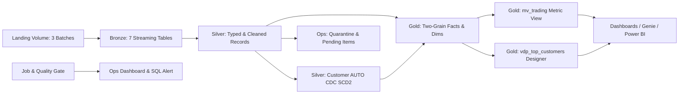

# Meridian Trading

Meridian Trading is an end-to-end Lakehouse data product built on Databricks Free Edition for the TPCH wholesale trading domain. It ingests three incremental batches of Parquet data across seven entities via Lakeflow Declarative Pipelines into a Medallion architecture (Bronze, Silver, Gold). The platform enforces SCD Type 2 customer history, delayed header resolution, ABAC tag-based security, unified metric views, operational quality gates, and multi-surface consumption across Genie, native Lakeview Dashboards, and Power BI.

## Quick start

```bash
pytest tests/
databricks bundle validate -t dev
databricks bundle deploy -t dev
databricks bundle run meridian_t02_job --params batch=1 --no-wait -t dev
```

Run batches 2 and 3 sequentially with `--params batch=next`. Completed batches skip redundant writes via Volume sentinel markers.

## Architecture



## Layout

- `src/landing/`: Deterministic Parquet batch simulator (`simulate.py`, `batch_plan.py`).
- `src/pipeline/`: Lakeflow Pipeline definitions for Bronze, Silver, SCD2 customer history, Gold facts, and Ops.
- `src/quality_gate/`: 19 diagnostic invariant checks evaluated at each job run (`quality_gate.py`).
- `lakeflow_designer/`: Lakeflow Designer notebook counterpart and visual pipeline export.
- `sql/governance/`: Governed tags, row filters, column masks, ABAC policies, and audit query.
- `sql/metric_views/`: Unified multi-grain metric view (`trading_metrics.sql`).
- `docs/`: Guides for [Genie](docs/genie.md), [Dashboards](docs/dashboards.md), and [Power BI](docs/power_bi.md).

## Gold tables and grains

| Table | Declared Grain | Purpose |
|---|---|---|
| `fct_order_headers` | One row per validated order header | Order status, total amount, customer version join |
| `fct_order_items` | One row per lineitem `(order_key, line_number)` | Revenue, quantity, discounts, delivery metrics |
| `dim_customer_history` | One row per customer version `[valid_from, valid_to)` | SCD Type 2 customer history with market segment |
| `dim_nations` | One row per nation | Geographic dimension linked to region |
| `dim_regions` | One row per region | Top-level geographic hierarchy |
| `dim_parts` | One row per part | Part metadata and pricing |
| `dim_suppliers` | One row per supplier | Supplier details and account balance |
| `vdp_top_customers` | Top 10 customers per segment at order time | Lakeflow Designer ranking data product |

## Silver contract

- **Lineage**: Each table records `_source_file`, `_ingested_at`, and `_batch_id`.
- **Deduplication & Hygiene**: Primary keys are deduplicated taking latest `_source_file`. Invalid rows (null keys, negative quantities, discount > 1.0) route to `ops.quarantine_records`.
- **Delayed Headers**: Items arriving before headers (5 items in batch 2) are held in `ops.pending_order_items` and linked in batch 3 upon header arrival.
- **SCD Type 2**: Customer segment updates use Lakeflow `AUTO CDC` tracked on `c_mktsegment` with `effective_date` sequencing, generating `__START_AT` and `__END_AT`.

## Seven KPI definitions

| KPI | Formula / Definition | Grain |
|---|---|---|
| Net revenue | `SUM(l_extendedprice * (1 - l_discount))` | Lineitem |
| Order count | `COUNT(DISTINCT o_orderkey)` | Header |
| Average order value | `Net Revenue / Order Count` | Header + Lineitem |
| Delivery days | `AVG(DATEDIFF(l_receiptdate, l_shipdate))` | Lineitem |
| Late delivery rate | `COUNT_IF(l_receiptdate > l_commitdate) / COUNT(*)` | Lineitem |
| Return rate | `COUNT_IF(l_returnflag = 'R') / COUNT(*)` | Lineitem |
| Discount given | `SUM(l_extendedprice * l_discount)` | Lineitem |

All seven KPIs are declared in a single YAML 1.1 metric view (`gold.mv_trading`) linking headers and lineitems via a `one_to_many` join.

## Security model

Row access and column masking are governed independently through Unity Catalog:

| Role / Group | Row Security (`gov.region_nation_filter`) | Column Masking (`gov.mask_*`) |
|---|---|---|
| `t02_admins` | Full access across all regions and nations | Governed by PII group membership |
| `t02_pii_readers` | Governed by regional entitlements | Full unmasked phone and balances |
| Standard Consumer | Restricted to assigned `region_key` / `nation_key` in `gov.entitlements` | Masked phone (`XXX-XXX-1234`), NULL balances |

### Governed tags & ABAC

| Tag Name | Allowed Values | Applied To |
|---|---|---|
| `medallion_layer` | `landing`, `bronze`, `silver`, `gold` | Schemas |
| `pii_type` | `contact`, `financial`, `government_id`, `none` | Sensitive columns |
| `sensitivity_level` | `public`, `internal`, `confidential`, `restricted` | Classified columns |

Catalog policies `mask_contact_pii` and `mask_financial_pii` dynamically apply masking functions to any column tagged with `pii_type = 'contact'` or `'financial'`.

## Decisions

- **Pure SQL Pipelines**: Core pipelines use declarative SQL for transparent execution plans and lineage graphs.
- **Tag-Driven ABAC**: Centralized ABAC policies eliminate repetitive column-level `SET MASK` statements across environments.
- **Serverless Compute**: Utilized for Lakeflow pipelines to eliminate cluster startup latency and stay within Free Edition resource bounds.

## Deviations

- **7 KPIs Implemented**: Exceeds the 4-6 KPI requirement to provide complete trading analytics.
- **Production Mode in Dev Target**: `databricks.yml` uses `mode: production` in dev to maintain stable schema names (`meridian_t02_dev`) without user prefixes.
- **Cohort Sampling**: Sampled with `c_custkey % 500 = 0` (2,000 headers/batch) to avoid Free Edition quota limits while exercising 100% of pipeline invariants.
- **Lakeflow Designer Draft**: Canvas draft exported and versioned in repository; executable task is backed by [top_customers.py](lakeflow_designer/top_customers.py).

## Results

- **3-Batch Execution**: Dev and prod completed all 3 batches (2,248 headers, 9,109 items) with zero remaining pending items.
- **Exact Metric Reconcile**: Metric View revenue matches fact lineitems to the penny ($331,502,003.34).
- **Quality Gate**: 19 of 19 checks pass in production across all batches; alert trigger and selective repair verified.
- **Evidence Screenshots**: [Catalog](evidence/p1_catalog.png), [Groups](evidence/p1_groups.png), [Dashboard](evidence/p6_dashboard.png).

## Official documentation

Refer to Databricks guides for [Lakeflow Declarative Pipelines](https://docs.databricks.com/aws/en/ldp/), [Unity Catalog Metric Views](https://docs.databricks.com/aws/en/uc-semantics/metric-views/), [ABAC Policies](https://docs.databricks.com/aws/en/data-governance/unity-catalog/tags-and-attributes), and [Asset Bundles](https://docs.databricks.com/aws/en/dev-tools/bundles/).
