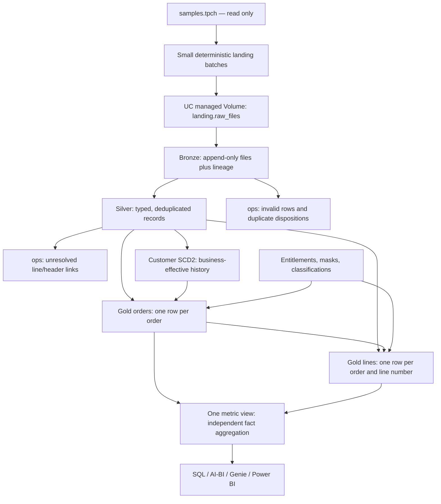

# Phase 0 architecture

Status: design proposal; source types, selected dates, and remote capabilities still need live evidence. Reviewed against both local assignment attachments on 2026-10-25. No ingestion, job, or pipeline is implemented in this phase.

## Why these layers exist

The business needs the same revenue and customer-segment answer in SQL, dashboards, Genie, and Power BI. A raw file is an arrival record; a fact is a business event. Keeping those separate lets us explain duplicates, delayed headers, and corrections without losing the original evidence.

Bronze is the loading dock, Silver is the inspection area, and Gold is the showroom. Governance controls which rows and columns a visitor can see.



## Objects and grains

| Layer / object | One row means | Important behavior |
|---|---|---|
| `landing.raw_files` | File storage, not a table | `{entity}/batch=NNN/`; at least three disjoint batches |
| `bronze.<entity>` | One physical source record received | Preserve bad rows, duplicates, `_source_file`, `_ingest_ts`, `_batch_id` |
| `silver.orders`, `silver.order_lines` | One valid business key | Business-friendly types; deduplication has an explicit disposition |
| `silver.customer_history` | One customer version | CDC tracks business-effective transitions |
| `ops.quarantine_invalid` | One invalid physical record | Keep reasons and source lineage |
| `ops.duplicate_dispositions` | One discarded duplicate occurrence | Reconcile physical Bronze counts |
| `ops.pending_order_lines` | One valid line awaiting a valid header | Recompute against current headers; also retain transition evidence |
| `gold.dim_customer_scd2` | One customer and validity interval | Unique version key; half-open intervals |
| `gold.dim_nation`, `gold.dim_region` | One nation / region | Each nation has one parent region |
| `gold.dim_part`, `gold.dim_supplier`, `gold.dim_date` | One part / supplier / calendar date | Conformed descriptive dimensions |
| `gold.fct_orders` | One order header | Unique `order_key_hash`; exactly one customer version |
| `gold.fct_order_lines` | One order and line number | Unique `(order_key_hash, line_number)`; same customer version as header |
| `gold.vdp_top_customers` | One ranked customer and order-time segment | Aggregate revenue then rank within each segment |
| `gold.mv_trading` | Semantic measures, not a new physical fact | Planned multi-grain view; requires a live feature test |

All target schema names use `${var.schema_prefix}` with `${var.catalog}`. The preferred prefix is empty; the workspace-catalog fallback prefixes **every** schema with `tNN_`, including the landing Volume schema. Group names derive from `var.nn`.

## Three decisions that prevent wrong answers

**Two fact grains.** An order worth 100 with three lines appears three times after a raw join. `COUNT(*)` would count three orders and summing the header amount would produce 300. A deterministic hash links the records, but does not prevent this fan-out. The metric view must aggregate header measures at header grain and line measures at line grain. Reconcile each side independently, including grouping and filtering by line attributes. See [ADR-002](decisions/adr-002-order-key-hash.md) and [ADR-003](decisions/adr-003-kpis.md).

**History at order time.** Slowly changing dimension Type 2 (SCD2) stores a new customer version when tracked attributes change. Its validity interval is `[valid_from, valid_to)`; an open interval has a NULL end. Lookup uses the order's business date:

```sql
o.customer_key = c.customer_key
AND o.order_date >= c.valid_from
AND (o.order_date < c.valid_to OR c.valid_to IS NULL)
```

Exactly one version must match. Count matches before publishing facts: zero is unresolved, more than one is a history error. Joining to `is_current` would rewrite historic revenue into today's segment. The simulator uses a baseline snapshot effective at the window start, followed by two dated changes inside the window. CDC generates the end bounds; they are not precomputed input history. See [ADR-004](decisions/adr-004-source-and-history.md).

**Delayed headers.** Auto Loader can ingest a file incrementally, but a streaming join to a static header snapshot does not automatically revisit unmatched old lines. Keep valid lines in Silver and derive pending/resolved sets with materialized views (results recalculated on refresh). Once a header arrives, the next refresh removes its lines from pending and includes them exactly once in the resolved Gold set. Invalid rows and temporarily pending rows are separate dispositions.

## Security and consumption

The entitlement hierarchy follows the **customer's** nation and region, including on the line fact. Supplier geography is a separately named reporting role. Both facts and exposed dimensions need independent protection; protecting one join input is insufficient. `tNN_admins` grants all rows; `tNN_pii_readers` grants unmasked values. Neither implies the other. See [security_model.md](security_model.md).

Consumers receive access to governed Gold objects only. Dashboard publishing identity, Genie permissions, and Power BI refresh identity must be checked because they can differ from the pipeline identity. No dashboard, export, or security result is claimed yet.

## Orchestration and unresolved dependencies

Later phases will add one pipeline resource with Bronze/Silver/Gold definitions, then one job for landing, pipeline update, quality gate, and dependent consumption tasks. Keep schedules paused until the Phase 10 demonstration and respect the brief's task/pipeline quotas. There are no resources in the current bundle.

The [capability matrix](capability_matrix.md) records runtime support, governed-tag access, group scope, UI availability, and fallback decisions. A CLI command existing does not prove a workspace feature works.

## Implementation mapping (2026-10-25, Phases 1–10 generated)

The design above is implemented as: `resources/pipeline.yml` (one serverless
pipeline; the five files under `src/pipeline/` build every dataset listed in
the table above, with `${catalog}`/`${schema_prefix}` parameters from
`databricks.yml`), `resources/job.yml` (land → pipeline update → quality gate,
schedule paused), `src/landing/` (deterministic batches per the contract's
batch plan), `src/quality_gate/` (manifest reconciliation + fail-on-bad), and
manual SQL under `sql/` (setup, governance, metric view, analysis).

Deviations from the table: `gold.dim_date` is not built — `order_date`/date
functions cover the demo questions; `gold.vdp_top_customers` is the
Designer-built VDP (`lakeflow_designer/README.md`), not a pipeline dataset.
`silver.customer_snapshot` (per-batch validated snapshots feeding
`AUTO CDC FROM SNAPSHOT`) was added to Silver per ADR-004.

One live-verified platform fact changed the Silver implementation: this
pipeline runtime rejects non-time-window functions (the `row_number` dedup)
on streaming reads (`NON_TIME_WINDOW_NOT_SUPPORTED_IN_STREAMING`). Silver's
`orders`/`order_lines`/`customer_snapshot` are therefore **materialized
views** (recomputed per update; expectations still drop invalid rows;
"newest file wins" dedup preserved), while Bronze stays append-only
streaming — Auto Loader still ingests only newly landed files per update.
