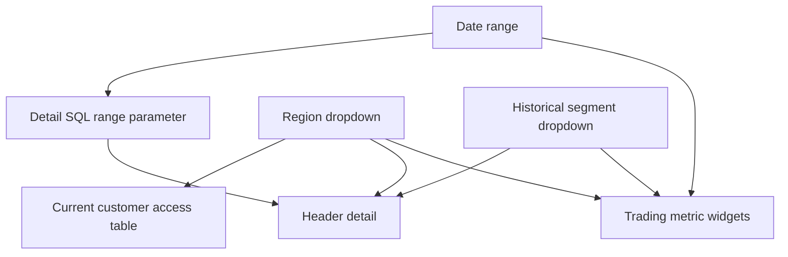

# Meridian dashboards: build, appearance and validation

The trainer wants one governed business surface and a separate operational surface. Build a single business page and the required two operations pages. Versioned native definitions are in `src/dashboards/`; the production bundle owns their existing IDs. Edit the existing native dashboards and preserve those IDs.

## Sources, identity and design

| Dashboard | Main source | Audience |
|---|---|---|
| Meridian Trading — Revenue and fulfillment | `gold.mv_trading` | Business users with Gold-only access |
| Meridian Trading — Operations | `ops` views over current system schemas, event log, and gate | Engineer/admin |

Use warehouse `7c433c4d75a98ff6`. Production dataset contexts are `meridian_t02_prod.gold` and `meridian_t02_prod.ops`; development deployments contain no dashboard resources. Dataset SQL uses bare names so bundle catalog/schema settings control the target. Publish the business dashboard **without embedded credentials**: each viewer must have their own underlying permissions. Publish operations for engineers; do not grant business users raw quarantine or system data.

Use a light gray canvas `#F3F6F7`, white cards, dark navy text `#183042`, and teal selections `#007F86`. The five series colors are teal, blue, amber, purple and orange. Keep a stable segment-to-color mapping across charts and Power BI. Avoid decorative gauges, pie charts with many categories, invented thresholds, and forecasts over this small synthetic cohort.

Counters need room: width 3, height 3 on the 12-column grid. Charts use width 6, height 5; tables use the full width. Use plain chart titles, visible axes, percent formatting for 0–1 rates, and two decimal places for monetary-unit amounts. Do not label source amounts USD unless the trainer explicitly establishes a currency.

## Business page: intended appearance

```text
MERIDIAN TRADING | REVENUE AND FULFILLMENT
1995 demonstration cohort · sample monetary units · order-time segments
[Order-date range]             [Customer region]       [Order-time segment]
[Net revenue] [Orders]         [Average order value]    [Return rate]
[Monthly revenue by segment — line]                    [Region revenue — bars]
[Late-delivery rate by region — bars]                  [Discount by segment — bars]
[All seven KPIs by region — comparison table]
[Order-header detail — dates, region, segment, status and original header price]
[Current customer access check — phone and balance masks]
[Compact KPI definitions and scope]
```

The access check is a current-profile snapshot. Order-date and historical-segment filters do not apply to it; the region filter does. The header detail shows original `order_total_price`, which includes the source's pricing conventions. The KPI revenue is discounted line revenue excluding tax; the two should not be presented as equivalent.

## Field assignments

| Visual | Dataset | Category | Value / fields |
|---|---|---|---|
| Four cards | `trading` metric source | None | `MEASURE(net_revenue)`, `MEASURE(order_count)`, `MEASURE(average_order_value)`, `MEASURE(return_rate)` |
| Monthly trend | `trading` | `order_month`; color = historical segment | `MEASURE(net_revenue)` |
| Regional revenue | `trading` | `region_name` | `MEASURE(net_revenue)` |
| Regional lateness | `trading` | `region_name` | `MEASURE(late_delivery_rate)` |
| Discounts | `trading` | Historical segment | `MEASURE(discount_given)` |
| Seven-KPI table | `trading` | Region | All seven `MEASURE()` values |
| Header details | `order_detail` | Raw rows | Header key/date, geography, segment, status, original price |
| Access table | `customer_access` | Current customer | Phone, balance, geography |

Do not sum monthly AOVs or average regional return rates. A metric-view widget recomputes the measure under the selected filters. The seven-KPI table exposes delivery days and discounts alongside the four headline cards.

## Filters versus parameters

The region and historical-segment controls bind to fields. The date-range control binds both to `trading.order_date` and the `order_detail.report_window` parameter. Detail SQL filters before returning rows:

```sql
SELECT order_key, order_date, region_name, nation_name,
  market_segment_at_order_time, order_status, order_total_price
FROM fct_order_headers
WHERE order_date BETWEEN :report_window.min AND :report_window.max
ORDER BY order_date DESC, order_key;
```

This meets the explicit parameter and filter requirements. Default the detail parameter to 1995-01-01 through 1995-12-31. The metric cohort already contains only 1995 orders. Apply identical date selections to both bindings and verify the header count in the detail table matches the card.

## Build and publish

1. Complete all three incremental batches and the gate before using final totals.
2. Inspect `DESCRIBE` for each source. Test every dataset query and every metric aggregation against the warehouse.
3. Import the native JSON or deploy its bound bundle resource. Keep business ID `01f1d0c30bc61590aad90b67ae5df1a5` and operations ID `01f1d0c3172f1f619a0fb3eb410c857e`.
4. Open the real canvas. Inspect every widget for data, supported versions, titles, formats, and matching field bindings.
5. Set the default date range and test one-month, single-region, and single-segment selections. Confirm filters reach the intended datasets.
6. Use the dashboard's AI assistance for one chart, inspect it, and correct any field or aggregate choice. Capture the actual draft/review; a generated JSON chart alone does not prove the AI-assistance step.
7. Publish without embedded credentials. Grant viewers the dashboard, warehouse usage, catalog/schema usage, and Gold read permissions as required.
8. Add a low-frequency refresh schedule after the final load. For the assessment, perform one scheduled refresh and pause it to preserve Free Edition quota. Check whether the schedule supports the chosen viewer-credential publication in this workspace; document the platform behavior.
9. Demonstrate a fresh restricted view with one region/nation entitlement and both PII/admin memberships removed. Capture partial phones and NULL balances alongside filtered revenue. Restore refresh access.

## Three saved SQL Editor queries

Save the existing SQL files with typed values, not text substitutes for all types:

| File | Parameters | Default |
|---|---|---|
| `sql/analysis/monthly_metrics.sql` | `start_date`, `end_date`: Date | 1995-01-01, 1996-01-01 exclusive |
| `sql/analysis/region_fulfillment.sql` | `region`: Text | ALL |
| `sql/analysis/top_customers.sql` | `minimum_revenue`: Number | 0 |

Inspect the saved parameter types in SQL Editor and capture `p6_typed_queries.png`. At least the first two query the metric view. Production copies use `meridian_t02_prod`; development checks substitute `meridian_t02_dev` consistently.

## Operations page 1: run health

```text
MERIDIAN TRADING | RUN HEALTH
[Latest project run: ID / environment / state / duration]
[Run duration trend, colored by result]     [Average task duration — ranked bars]
[Expectation failures by dataset — bars]    [Quarantine by batch and entity — bars]
[Pipeline update history]
[Quality gate: timestamp / batch / run ID / check / status / value / diagnostic]
[Expectation pass and fail counts per update]
```

Use `system.lakeflow.job_run_timeline`, `job_task_run_timeline`, and `pipeline_update_timeline`, restricted by workspace and exact project job IDs. An hourly timeline can have several records for one run; the ops views group them before charting. Keep the latest completed result from the last interval. Do not assume a job-name column exists.

The event-log view explodes expectation records into `(update_id,dataset,expectation,passed_records,failed_records)`. Expectations can overlap, so summed violations are **rule failures**, not the number of distinct rejected rows. Use quarantine for rejected record counts. Batch 2 pending items are held for late headers; they are not validation rejects.

The deliberate gate failure must remain in the quality table after repair. Show both failed and passed attempts with the same run ID and different timestamps. A refreshed latest-status card alone would hide the lesson.

## Operations page 2: cost and usage

```text
MERIDIAN TRADING | COST AND USAGE
Workspace usage in DBU · project duration · warehouse performance · Gold lineage
[Daily workspace DBU by SKU — line]          [Total project task time — ranked bars]
[Slowest warehouse queries: duration, read rows, produced rows]
[Recorded source → Gold lineage]
```

`system.billing.usage` is workspace-wide; do not claim exact Meridian cost without reliable attribution. `usage_quantity` is measured in `usage_unit`; keep the chart restricted to DBU. Elapsed task seconds are a performance measure, not a billing total. Query history is bounded to the selected warehouse. Lineage is restricted to the relevant Gold targets and last 30 days.

System tables can lag behind job/pipeline APIs. Record the observation time and use the API to confirm immediate run state. If a system schema is unavailable, document a concrete API-derived ops table with timestamps and source IDs; do not create pretend system rows. The saved-session dataset SQL checks executed, including a corrected event-log query. Recheck a dataset after changing its SQL or when the actual workspace reports an error.

## Genie Code prompts

```text
Build the Meridian business dashboard from gold.mv_trading using native AI/BI widgets.
Use four cards: net revenue, header order count, AOV and return rate; show a monthly
revenue line by historical segment, ranked region revenue, region late rate, segment
discounts, a seven-KPI comparison table and header detail. Bind the date control to
the metric field and detail query range parameter. Add region and segment filters.
Keep current-customer masking proof separate from order-date filters. Use the teal
palette and 12-column layout in docs/dashboards.md. Test all SQL and filtered measures
before deployment; publish with each viewer's credentials. Show chart field settings.
```

```text
Draft one chart of monthly net revenue by market_segment_at_order_time from mv_trading.
Use order_month on X, MEASURE(net_revenue) on Y, and segment as color.
Show the selected fields and aggregation so I can review them before accepting it.
```

```text
Build two operations pages from ops_views.sql: run health and cost/usage.
Use exact job/workspace filters, event-log expectation counts, persisted quality-gate
attempts, DBU usage with honest scope, slow queries and recorded Gold lineage.
Keep the deliberate failed and repaired attempts visible. Inspect source schemas,
execute each query, and explain any telemetry lag instead of inventing results.
```

## Validation and evidence

Reconcile the four cards and all seven table values with independent Gold SQL overall and for a selected month/region/segment. Check the rate denominator is all valid lines. Under restricted access, verify the same query, dashboard and external BI refresh agree.

Capture `p6_business_dashboard.png`, `p6_parameter_filter.png`, `p6_ai_chart_review.png`, `p6_publishing.png`, `p6_restricted.png`, `p6_scheduled_refresh.png`, `p7_run_health.png`, `p7_usage.png`, and `p7_failed_repaired.png`. Inspect the actual rendered canvas; JSON structure checks do not prove appearance.

See [Power BI](powerbi.md), [Genie](genie.md), [assessment checklist](assessment_checklist.md), and [live checks](../NEEDS_LIVE_CHECK.md).

References: [AI/BI dashboards](https://docs.databricks.com/aws/en/dashboards/), [event-log queries](https://docs.databricks.com/aws/en/ldp/monitor-event-logs).

## UI walkthrough: create or edit every business visual

The resources now belong only to the production bundle target. Production dataset context is `meridian_t02_prod.gold` for business and `meridian_t02_prod.ops` for operations. Development deployments contain no dashboard resources. This prevents two targets from overwriting the same IDs or creating duplicate dashboards.

1. In the workspace sidebar open **Dashboards**. Open **Meridian Trading - Revenue and fulfillment**, then **Edit draft**. Keep the existing dashboard instead of creating a replacement.
2. Select the warehouse at the top. On the **Data** tab, inspect `trading`: it is the metric-view asset `mv_trading`, not a SELECT that copies every line. Confirm the effective catalog is production.
3. Inspect `order_detail` and `customer_access` queries on Data. Run each. Missing source or field errors must be corrected here before formatting widgets.
4. Return to **Canvas**. Use **Add → Text** for title and scope. Use **Add → Visualization** for charts and counters; drag/resize on the 12-column grid.
5. Select a widget to open its configuration pane. Choose its dataset, visual type, fields, format and title. For metric fields choose the named measure; avoid a second SUM over an already aggregated ratio.
6. Add four **Counter** widgets. Choose net revenue, order count, average order value and return rate. Set units, separators and percentage formats as in the field table above.
7. Add **Line**. Choose `order_month` on X, net revenue measure on Y, and historical segment for Color. Sort month ascending, show Jan–Dec, retain all five series and full values in tooltips.
8. Add **Bar**, horizontal orientation: region on Y and net revenue on X. Sort by revenue descending. Start the numeric axis at zero.
9. Repeat horizontal bars for late rate by region and discount given by segment. Rate axis/labels use percent; discount labels use monetary units. Separate delivery days from percent charts.
10. Add **Table** for all seven KPI values by region. This makes delivery days and discounts visible even though only four measures are headline counters.
11. Add the order-detail Table. Select the natural order key/date, region/nation, order-time segment, status and original header price. Do not sum IDs. Name the price “Original header price” so it is not confused with discounted line revenue.
12. Add the current-customer Table for access checking. Show customer key, geography, phone and balance. Label it “Current customer profiles — access check.” It is a snapshot, not a historical revenue detail.
13. Add a short Text widget explaining the seven definitions and exclusions. Keep enough space for the access/definition section; the business canvas may scroll rather than squeeze every table into a small screen.

### Connect the three controls

1. Add a **Date range** filter/control. Set its default to January 1 through December 31, 1995.
2. Add `trading.order_date` to its fields. Add `order_detail.report_window` to its parameter bindings so the SQL detail query uses `.min`/`.max`.
3. Add a region **Dropdown**. Connect `trading.region_name`, `order_detail.region_name` and `customer_access.region_name`.
4. Add a historical segment **Dropdown**. Connect `trading.market_segment_at_order_time` and the same header-detail field. Do not connect it to the current profile's segment.
5. Test July + EUROPE + HOUSEHOLD. The four cards, KPI table, line/bars and header details must all use the intended scope. Clear filters before publishing the default view.
6. Verify that the date control changes metric calculations at source; the metric view's measures must be recomputed under selection, not cached as global counters.



### AI-assisted chart proof

Select the monthly-trend area and open the dashboard's AI/Genie Code assistance. Paste the one-chart prompt above. Capture the generated suggestion, inspect X/Y/Color, correct any use of current segment or header-price revenue, and capture the corrected chart. Record the actual correction in a short screenshot caption. An unchanged suggestion is acceptable only after checking the fields and formulas.

### Publish, permissions and refresh

1. Click **Publish**. Select publication **without embedded credentials**. Capture the choice.
2. Share with the intended consumer identity/group. Dashboard permission does not replace SQL warehouse `CAN_USE` or Unity Catalog catalog/schema/table privileges.
3. Open the published page as the relevant query identity and force a new query after changing memberships. Show both row-filtered KPIs and masked contact/balance results.
4. Wait until `is_member('t02_admins')` and `is_member('t02_pii_readers')` are both FALSE before accepting restricted evidence. The successful live test observed several minutes of propagation.
5. For the scheduled-refresh requirement open the dashboard's schedule controls, use the existing paused daily 07:00 Asia/Kolkata schedule, allow one scheduled execution and pause it. If the UI restricts refresh options for viewer-credential publication, document the precise behavior and the schedule's execution identity; preserve secure publication.
6. Verify the refresh history and published appearance. A schedule definition alone does not prove a scheduled refresh occurred.

## UI walkthrough: operations pages

1. Open **Meridian Trading - Operations → Edit draft → Data**. Run each ops dataset and inspect its columns. The native JSON already has the two pages; edit them in place.
2. On **Run health**, use a latest-run Table, a run-duration Line, horizontal task-duration Bars, expectation-failure Bars, quarantine Bars, update-history Table and persisted gate Table. Keep the exact run ID visible in the gate table.
3. On **Cost and usage**, use a daily DBU Line/Area by SKU, task-duration Bars, slow-query Table and Gold-lineage Table. Use the page subtitle to state workspace-wide billing scope.
4. For the failed/repaired run, filter gate data to `914144933967324` in development evidence. Show the deliberate failed check followed by the repaired 19 passing checks. In production telemetry distinguish the actual production job from that development demonstration.
5. Run duration is wall-clock elapsed time from first start to last end, including repairs. Task durations group by each task-run ID. Repair intervals can overlap; summing job timeline intervals inflated one observed duration, so the final ops view uses earliest start/latest end.
6. In **SQL → Alerts** open the latest-run alert. Inspect the exact job filter, threshold `latest_run_failed = 1`, schedule and history. The native task evidence includes `TRIGGERED` then `OK`; email delivery itself is not asserted.
7. Capture both rendered pages and their filters. Mark empty/later-arriving system telemetry honestly.

## Visual choice rules

| Insight | Choose | Configuration |
|---|---|---|
| One KPI | Counter | Clear unit and scope |
| Monthly movement | Line | Chronological month axis; segment color |
| Regions/segments ranked | Horizontal Bar | Sort descending; zero origin |
| Delivery/return fractions | Bar + percent labels | One denominator definition |
| Customer/order audit | Table | Exact keys and validity dates |
| Expectation failures | Bar | Rule failures, not unique rejects |
| Quality gate history | Table | Run, attempt timestamp, status, diagnostic |
| Resource usage over time | Line/Area | DBU or actual usage unit, explicit scope |
| Lineage/architecture explanation | Mermaid diagram | Actual source/target edges |

Use [guidelines](guidelines.md) for colors, accessibility and screenshot conventions, and [presentation](presentation.md) for the demo order.

## A concrete build/review exercise

Use July 1995, EUROPE and HOUSEHOLD as the common scope. First select these controls in the business dashboard; then run the equivalent metric query in SQL Editor:

```sql
SELECT MEASURE(net_revenue) AS net_revenue,
       MEASURE(order_count) AS order_count,
       MEASURE(average_order_value) AS average_order_value,
       MEASURE(delivery_days) AS delivery_days,
       MEASURE(late_delivery_rate) AS late_delivery_rate,
       MEASURE(return_rate) AS return_rate,
       MEASURE(discount_given) AS discount_given
FROM meridian_t02_prod.gold.mv_trading
WHERE order_date >= DATE '1995-07-01' AND order_date < DATE '1995-08-01'
  AND region_name = 'EUROPE'
  AND market_segment_at_order_time = 'HOUSEHOLD';
```

Compare all seven values with the regional KPI table, and the four headline values with the counters. Counts must match exactly; monetary values within 0.01 sample units; ratio/day differences within 0.000001. Clear the filters and repeat overall. The customer-access table remains a current-profile view; only its region control is connected.

If the counter is correct overall but wrong under filtering, inspect whether it uses a native metric measure or a precomputed global value. If detail rows disagree, inspect the Date range parameter's `.min`/`.max` binding and category field bindings. Keep source values typed and ratios computed after filtering.

For the AI-chart evidence, use the assistant available **inside the dashboard editor**. Ask for one monthly line chart, then explicitly inspect month axis, historical segment color and net revenue measure. An engineering prompt pasted into the business Genie chat does not build a dashboard canvas.

### Why each section belongs on the page

The counters answer “how much/how many.” The monthly trend answers “when.” Region/segment bars answer “where/which group.” The seven-KPI table exposes the complete assignment's measures with exact values. Header detail allows record investigation, while the current-customer table proves access controls. Scope/definitions prevent viewers from confusing source header price with discounted item revenue.

The operations page answers a different set of questions: did the refresh run, which task was slow, which rules failed, and what compute was used? Keep its privileged data access and workspace billing scope explicit. Use [the presentation flow](presentation.md) to connect both dashboards to the pipeline and governance proof.
