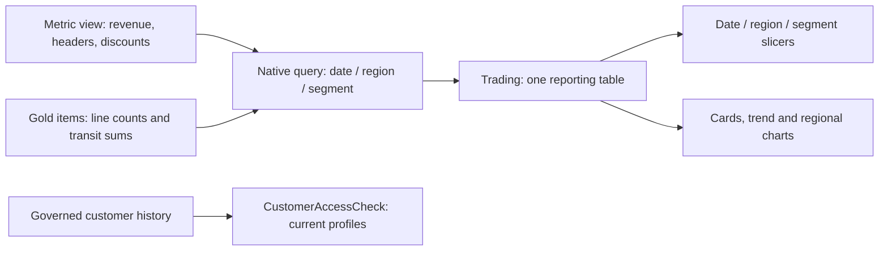

# Power BI: revenue and fulfillment

Build one report page using the same governed data as Databricks. The native queries, DAX and theme are prepared; a working `.pbix` and screenshots require Power BI Desktop on Windows. This file describes the exact build and the evidence that completes Phase 9.

## Sources and connection

| Setting | Value |
|---|---|
| Server hostname | `<your-databricks-hostname>` |
| HTTP path | `/sql/1.0/warehouses/7c433c4d75a98ff6` |
| Catalog / database | `meridian_t02_prod` / `gold` for the final report; use development only for a deliberately labeled test |
| Reporting source | [trading.sql](../power_bi/trading.sql) |
| Mask verification source | [customer_access.sql](../power_bi/customer_access.sql) |
| Measures | [measures.dax](../power_bi/measures.dax) |
| Theme | [theme.json](../power_bi/theme.json) |

Follow the detailed Desktop steps below using the production SQL files. The connection dialog's **Native query** option is the supported path; `Databricks.Query` in DirectQuery is unsupported.

DirectQuery keeps source queries governed and allows rates to recompute when filters change. All tools share one 2X-Small warehouse, so keep the page and queries small. Check connector folding and response time before the demonstration.

## Model contract

`Trading` has one row per order date, customer region and customer segment **at order time**. It contains header counts and additive line components. Use one main table for all slicers and KPI visuals. No fact-to-fact relationship or additional calendar model is needed for this 1995 demonstration.



Header counts are additive at this particular grain because each order has one date, region and order-time segment. Return and late rates divide summed line counts; delivery days divides summed transit days by line count. Never average daily percentages or average-order values. The native SQL preserves groups with headers but no retained valid items.

Keep `CustomerAccessCheck` independent of revenue slicers and label it **Current customer profiles — access check**. Its purpose is to prove row filtering and column masking on refresh, not to represent customer activity in a selected date window.

## Page appearance

Use a 16:9 page, 1280 × 720, neutral background `#F3F6F7`, white cards, dark text `#183042`, and teal `#007F86` accent. Keep colors for each segment consistent with the Databricks dashboard. Use 12–14 pt labels and 20–28 pt headings/card values; avoid tiny legends.

```text
MERIDIAN TRADING                              Date range | Region | Segment
1995 sampled orders · customer geography · order-time customer segment

[Net revenue]       [Orders]       [Average order value]       [Return rate]

[Monthly revenue by segment: wide line chart] [Revenue by region: ranked bars]
[Late delivery rate by region: percent bars]  [Delivery days by region: day bars]
[Discount given by segment]                  [Current customer access table]

Net revenue excludes tax. Monetary amounts are TPC-H demonstration units.
```

| Visual | Fields and configuration |
|---|---|
| Four cards | `[Net Revenue]`, `[Orders]`, `[Average Order Value]`, `[Return Rate]` |
| Monthly trend | X `order_month`, Y `[Net Revenue]`, legend `market_segment_at_order_time`; chronological axis |
| Region ranking | Y `region_name`, X `[Net Revenue]`; sort descending |
| Late delivery | Y `region_name`, X `[Late Delivery Rate]`; percentage labels |
| Transit time | Y `region_name`, X `[Delivery Days]`; label units as days |
| Discounts | Category `market_segment_at_order_time`, value `[Discount Given]` |
| Date slicer | `order_date`, Between mode, full 1995 initial selection |
| Region / segment slicers | Dropdowns from `Trading`; interact with all reporting visuals |
| Access table | Customer key/name, region/nation, phone, account balance from `CustomerAccessCheck` |

Format monetary amounts with separators and two decimals, without claiming a real USD ledger. Counts are integers; rates use percentage format with one decimal; days use one decimal. Disable automatic sums on keys. Use full values in tooltips. A separate unit must have its own axis or chart.

## Validation and security demonstration

1. Query all seven measures from `meridian_t02_prod.gold.mv_trading`. Compare the same order-date window, region and segment with the Power BI cards; use identical inclusive/exclusive date boundaries.
2. Repeat for one month and one region. Revenue/discount differences must be within 0.01 demonstration monetary units; counts exact; ratios within 0.000001.
3. While the connection user belongs to `t02_admins` and `t02_pii_readers`, capture the unrestricted report and current customer table.
4. Remove those memberships and grant one region in `gov.entitlements`. Force new connector queries after the change. Verify that only the permitted region/nations return, phone is partial, and balance is NULL.
5. Compare `CustomerAccessCheck` with the same SQL in Databricks under that identity. Re-add the engineer's refresh memberships when done.
6. Save the `.pbix` without credentials and capture `p9_powerbi_reconciliation.png` and `p9_powerbi_restricted_refresh.png`.

A published report uses its configured connection identity. DirectQuery alone does not apply every viewer's Databricks identity. If per-viewer SSO is unavailable, demonstrate the restricted connection identity and document that model honestly.

## Genie Code prompt while building

```text
Help me build one Power BI Desktop page for Meridian Trading from the files in power_bi/.
Use the Databricks connector's Native query option in DirectQuery mode.
Use one Trading table at date/region/order-time-segment grain and the supplied seven DAX measures.
Build four cards, monthly revenue by segment, regional revenue/late-rate/transit charts,
discounts by segment, and date/region/segment slicers.
Use ratios of additive components; never average percentages or sum average-order values.
Add the independent current-customer access table for phone/balance masking proof.
Apply the supplied neutral/teal theme. Show field assignments, formats, and slicer interactions.
Help me diagnose connector folding errors and reconcile each result with gold.mv_trading.
```

Business Genie validation question:

```text
For orders placed in July 1995 in EUROPE, show revenue, header order count,
average order value, delivery days, late delivery rate, return rate and discounts.
Use the governed metric view, show the generated SQL, and state the monetary-unit convention.
```

## Current references

- [Power BI integration](https://docs.databricks.com/aws/en/partners/bi/power-bi)
- [Desktop connection and native SQL](https://docs.databricks.com/aws/en/partners/bi/power-bi/desktop)
- [Metric-view joins and independent aggregation](https://docs.databricks.com/aws/en/uc-semantics/metric-views/joins)

## Step-by-step Desktop build

### Load and inspect

1. Install/use current Power BI Desktop on Windows. Open a blank report; choose **Home → Get data → More → Databricks**.
2. Copy connection details from **Databricks → SQL Warehouses → project warehouse → Connection details**. The server hostname has no `https://`; the HTTP path begins `/sql/1.0/warehouses/`.
3. Under **Advanced options**, enter `meridian_t02_prod` for catalog and `gold` for database/schema. Paste [trading.sql](../power_bi/trading.sql) into the connector's **Native query** field, selecting DirectQuery.
4. Authenticate in the connector dialog. Prefer supported OAuth. If the workspace requires a token, use a short-lived one through credential settings and revoke it after the demonstration. Never put credentials in a query, report parameter, screenshot or Git.
5. Rename the result `Trading`. In Power Query inspect types: dates → Date/DateTime as appropriate, keys → Whole number, counts → Whole number, monetary totals → Decimal/Fixed decimal. Set `order_month` to Date for chronological display.
6. Add [customer_access.sql](../power_bi/customer_access.sql) through the same connector as `CustomerAccessCheck`. Leave it unrelated to Trading; it is a current-profile security check.
7. Select **Close & Apply**. In Model view, avoid automatic relationships between these two tables. Set key columns' default summarization to **Don't summarize**.
8. Use **View → Themes → Browse for themes** and load [theme.json](../power_bi/theme.json).
9. In Report/Data view use **Modeling → New measure**. Add the seven expressions from [measures.dax](../power_bi/measures.dax), one measure at a time. A measure uses the calculator icon; do not create a calculated column containing repeated aggregate totals.

### DAX syntax and why

```dax
Net Revenue = SUM(Trading[net_revenue])
Orders = SUM(Trading[order_count])
Average Order Value = DIVIDE([Net Revenue], [Orders])
Discount Given = SUM(Trading[discount_given])
Return Rate = DIVIDE(SUM(Trading[returned_lines]), SUM(Trading[line_count]))
Late Delivery Rate = DIVIDE(SUM(Trading[late_lines]), SUM(Trading[line_count]))
Delivery Days = DIVIDE(SUM(Trading[transit_days_sum]), SUM(Trading[line_count]))
```

`SUM` aggregates additive components in the selected context. `DIVIDE` handles an empty/zero denominator safely. `AVERAGE(Trading[return_rate])` would weight a small date group as heavily as a large group; the ratio of sums uses every valid item equally. Header counts are additive here because each order belongs to one date/region/historical-segment group.

Set format strings to `#,0.00` for monetary values, `#,0` for orders, `0.0%` for rates, `0.0` for days. Currency is deliberately unspecified.

### Place the visuals

1. Click the page background and open **Format page → Canvas settings**. Select 16:9 or Custom 1280 × 720. Use `#F3F6F7` background.
2. Use **Insert → Text box** for the title and scope. Keep reporting filters at the top and the access-check table lower down.
3. In **Visualizations/Build a visual**, choose **Card** and place `[Net Revenue]` in its value field. Duplicate for Orders, Average Order Value and Return Rate, then change each field. Set titles, two-decimal monetary values, integer orders and one-decimal percentages.
4. Choose **Line chart**. X: `Trading[order_month]` as the raw column, not an automatically generated date hierarchy. Y: `[Net Revenue]`. Legend: `Trading[market_segment_at_order_time]`. Sort oldest first and show month labels.
5. Choose **Clustered bar chart**. Y/category: `Trading[region_name]`; X/value: `[Net Revenue]`; sort descending. Repeat for `[Late Delivery Rate]` and `[Delivery Days]`, keeping separate units.
6. Add segment-discount bars. Use segment as category and `[Discount Given]` as value.
7. Add a compact regional Table with all seven measures if the page has room; otherwise use the seven-KPI table in place of the three small delivery/discount charts to keep all measures readable. Keep the mandatory four cards/trend/region/date slicer readable.
8. Add a Table from `CustomerAccessCheck`: customer key/name, region/nation, phone and balance. Title it “Current customer profiles — access check.” A filtered-empty table is a valid no-entitlement state; capture nonempty permitted rows to prove masks.
9. Use **Insert → Text box** for two short definition/scope sentences. Explain that revenue excludes tax and customer segment is historical.

### Configure slicers and interactions

1. Add **Slicer**, field `Trading[order_date]`, mode **Between**, default full 1995 range.
2. Add dropdown slicers for region and order-time segment using Trading fields.
3. Select each slicer → **Format → Edit interactions**. Reporting visuals use Filter. `CustomerAccessCheck` uses None because it is a current-profile security snapshot.
4. Test July + EUROPE + HOUSEHOLD. Clear selections before the default screenshot.
5. Set tooltips to full monetary values/order count; display units such as Millions only for compact chart labels, without hiding units.
6. Keep stable segment colors from [guidelines](guidelines.md). Provide text labels and percentages, so color is not the only signal.

## DirectQuery and refresh interpretation

DirectQuery queries the SQL warehouse and avoids a full imported dataset for each change. It does not independently establish per-viewer Databricks SSO. On Desktop the connection identity governs the queries; a published Power BI Service report uses its configured connection unless supported SSO is explicitly configured.

For the assessment, refresh/requery as the restricted connection identity and verify actual source rows/masks. Clear any cached visuals and use **Home → Refresh**; if credentials change use **File → Options and settings → Data source settings → Clear/Edit permissions** and reconnect. Wait until Databricks SQL confirms the two project memberships are FALSE before accepting the result. DirectQuery cached displays can still show an earlier result until a fresh query runs.

Do not export an unrestricted imported report and call it secure because the source now masks columns. The report evidence must demonstrate the source identity and fresh restricted query.

## Reconciliation exercise

1. Select the same dates/region/segment in both tools.
2. Run the seven `MEASURE()` queries against production and record the result.
3. Compare Power BI measures overall and for July/EUROPE/HOUSEHOLD. Counts match exactly; revenue/discount within 0.01 sample unit; ratios within 0.000001.
4. Test a no-entitlement identity: source-backed facts should return no permitted rows. Add region then nation entitlement and compare permitted rows.
5. Demonstrate partial phones and NULL balances in the separate access table. Revenue-only charts cannot prove a contact mask.
6. Save the real `.pbix` locally after checking credentials are stored through connector settings rather than embedded M/query text. Keep it outside Git; submit the credential-free file as requested by the trainer.

## Troubleshooting without redesigning the model

| Symptom | Check |
|---|---|
| Warehouse unavailable | Start the project warehouse after pipeline work releases capacity; inspect Free Edition quota |
| Metric query not supported | Use the current Databricks connector Native query field and `MEASURE()`; verify DirectQuery support/folding |
| Date labels alphabetical | Use typed `order_month` and chronological sort |
| AOV too large | Divide aggregate revenue by header count; do not sum daily AOV |
| Rates wrong after filtering | Sum flags/counts before dividing |
| Restricted report still unmasked | Confirm current SQL membership FALSE, fresh connection queries, and actual customer columns selected |
| Report shows fewer than ten ranked customers | The ranking table is globally ranked, then access-filtered |
| A chart has USD labels | Use numeric sample monetary units unless the trainer establishes currency |

Genie Code can help generate/review SQL/DAX and explain the field assignments. It cannot create a Windows Desktop `.pbix` through a business Genie conversation. Capture the actual report and restricted refresh; this repository contains prepared SQL/DAX/theme and a design guide, not a fabricated report.

## Minimal readable one-page layout

For a crowded 16:9 canvas, keep the required three slicers, four cards, monthly trend, regional revenue and current-profile access check. Use a compact table with all seven measures by region instead of squeezing extra delivery/discount charts into the remaining space. This preserves every measure while keeping labels readable. The supplied blueprint is a design reference; choose the final spacing in Desktop using real data.

| Region table field | Format | Purpose |
|---|---|---|
| region_name | Text | Comparison category |
| [Net Revenue], [Discount Given], [Average Order Value] | #,0.00 | Sample monetary units |
| [Orders] | #,0 | Validated headers |
| [Delivery Days] | 0.0 | Item-weighted days |
| [Late Delivery Rate], [Return Rate] | 0.0% | Ratio of item counts |

In **View → Performance analyzer**, record one filter change and refresh to confirm DirectQuery sends work to the warehouse. Use source query history when you need proof that a restricted refresh actually queried again; a changed group membership and an unchanged cached visual are insufficient.

For final submission include the genuine `.pbix`, default page, July/EUROPE/HOUSEHOLD comparison and restricted current-profile capture. Keep the report outside Git and check SQL/M/parameters contain no credential strings. [Live status](../NEEDS_LIVE_CHECK.md) still marks the actual report and fresh restricted connector proof as pending.
