# Project Meridian — Trainer Presentation & Architecture Study Guide

> Comprehensive preparation kit for the **Project Meridian (Package 02: Wholesale Order-to-Revenue)** evaluation and trainer walkthrough.

This study guide explains every component of the lakehouse architecture, data modeling decisions, Lakeflow join mechanisms, Unity Catalog security policies, and answers to technical evaluation questions.

---

## Guide Modules

| Module | Title | Core Focus |
|---|---|---|
| [01. Business Domain & Dataset](file:///home/sameed/meridian-trading/evidence/study_guide/01_business_and_dataset.md) | Understanding TPC-H Wholesale Data | Entity relationship diagrams, business window (1995), sampling logic, and grain definitions. |
| [02. Pipeline Architecture & Joins](file:///home/sameed/meridian-trading/evidence/study_guide/02_pipeline_and_joins.md) | End-to-End Lakeflow Pipeline | Medallion data flow, Auto Loader ingestion, exact SQL join mechanics, and lineage tracking. |
| [03. Advanced Challenges Deep-Dive](file:///home/sameed/meridian-trading/evidence/study_guide/03_advanced_challenges.md) | The 3 Core Technical Mark Earners | Multi-grain Metric View, delayed order headers, and customer SCD Type 2 point-in-time joins. |
| [04. Governance & Tag-Driven ABAC](file:///home/sameed/meridian-trading/evidence/study_guide/04_governance_and_security.md) | Modern Unity Catalog Security | Governed tags, catalog-level ABAC masking policies, hierarchical row filtering, and `is_account_group_member`. |
| [05. Quality Gate & Monitoring](file:///home/sameed/meridian-trading/evidence/study_guide/05_quality_gate_and_ops.md) | Invariant Validation & Telemetry | Deterministic gate checks, quarantine capture, system table telemetry, and failure alerts. |
| [06. Design Choices & Trade-offs](file:///home/sameed/meridian-trading/evidence/study_guide/06_design_decisions_and_tradeoffs.md) | Architectural Decision Records | Why decisions were made, what alternatives existed, and the trade-offs on Databricks Free Edition. |
| [07. Trainer Demo & Interview Defense](file:///home/sameed/meridian-trading/evidence/study_guide/07_trainer_demo_and_interview_guide.md) | 15-Minute Walkthrough & Q&A | Pitch script, step-by-step live demo sequence, and answers to tricky questions the trainer might ask. |

---

## High-Level Architecture Overview

```mermaid
flowchart TD
    subgraph Landing["Landing Zone (Volumes)"]
        RawOrders["orders/batch={1,2,3}"]
        RawLines["lineitem/batch={1,2,3}"]
        RawCust["customer/batch={1,2,3}"]
        RawDims["nation, region, part, supplier (batch=1)"]
    end

    subgraph Bronze["Bronze Layer (Streaming Tables)"]
        B_Orders["bronze.orders"]
        B_Lines["bronze.lineitem"]
        B_Cust["bronze.customer"]
        B_Dims["bronze.{nation, region, part, supplier}"]
    end

    subgraph Silver["Silver Layer (Materialized Views & Streaming)"]
        S_Orders["silver.orders\n(Dedup & Validated)"]
        S_Lines["silver.order_lines\n(Dedup & Validated)"]
        S_CustChanges["silver.customer_changes\n(Streaming Feed)"]
        S_CustHist["silver.customer_history\n(Lakeflow AUTO CDC SCD2)"]
        OpsQuarantine["ops.quarantine_invalid"]
        OpsPending["ops.pending_order_lines"]
    end

    subgraph Gold["Gold Layer (Star Schema Facts & Dims)"]
        G_DimCust["dim_customer_scd2\n(WITH ROW FILTER)"]
        G_Dims["dim_nation, dim_region,\ndim_part, dim_supplier"]
        G_FctOrders["gold.fct_orders\n(Header Grain + PIT Join)"]
        G_FctLines["gold.fct_order_lines\n(Line Grain)"]
    end

    subgraph Consumption["Consumption & Governance"]
        MV["gold.mv_trading\n(YAML 1.1 Metric View - 7 KPIs)"]
        ABAC["Tag-Driven ABAC Policies\n(mask_contact_pii, mask_financial_pii)"]
        Gate["ops.quality_gate\n(13 Automated Invariant Checks)"]
        Dashboards["AI/BI Dashboards & Genie Space"]
    end

    Landing --> Bronze
    Bronze --> Silver
    Silver --> Gold
    Gold --> Consumption
```

