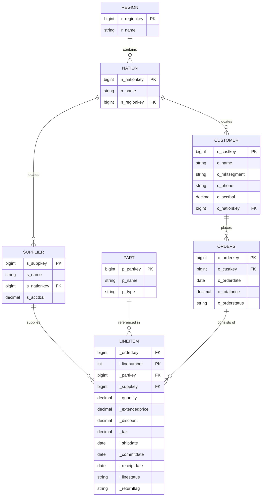

# Module 01: Business Domain & Dataset

## 1. Domain Context: Wholesale Order-to-Revenue

The project implements a modern governed lakehouse for **Meridian Trading**, a global wholesale distributor.
The business model involves:
- Taking wholesale orders from commercial customers across 5 worldwide market segments: `AUTOMOBILE`, `BUILDING`, `FURNITURE`, `HOUSEHOLD`, and `MACHINERY`.
- Supplying parts sourced from qualified suppliers located globally across 25 nations grouped into 5 regions.
- Fulfilling line items with dynamic pricing, volume discounts, shipping logistics, and handling customer returns.

---

## 2. Source Entities (TPC-H Benchmark)

The underlying dataset is derived from the standard industry benchmark **TPC-H** (`samples.tpch` on Databricks):



### Entity Grain & Attributes

1. **`orders` (Header Grain)**:
   - Primary Key: `o_orderkey`.
   - Business Meaning: One row per customer order placement.
   - Statuses: `O` (Open), `F` (Fulfilled), `P` (Pending).
   - Natural Total: `o_totalprice` = gross header total before line-level adjustments.

2. **`lineitem` (Line Grain)**:
   - Composite Primary Key: `(l_orderkey, l_linenumber)`.
   - Business Meaning: Individual item fulfillment within an order. Multiple line items belong to one order.
   - Financial Metrics: `l_extendedprice` (base price $\times$ quantity), `l_discount` (discount percentage, e.g. 0.05), `l_tax`.
   - Logistics Dates: `l_shipdate` (when leaves warehouse), `l_commitdate` (promised delivery date), `l_receiptdate` (actual customer delivery date).
   - Return Flags: `N` (None), `R` (Returned), `A` (Accepted).

3. **`customer` (Customer Profile Grain)**:
   - Primary Key: `c_custkey`.
   - Tracks corporate customers, their commercial market segment (`c_mktsegment`), contact phone (`c_phone`), and credit account balance (`c_acctbal`).

4. **`supplier` (Supplier Grain)**:
   - Primary Key: `s_suppkey`.
   - Contains supplier details and account balances (`s_acctbal`).

5. **`part` (Catalog Item Grain)**:
   - Primary Key: `p_partkey`.
   - Wholesale product catalog details.

6. **`nation` & `region` (Geographic Hierarchy)**:
   - 25 nations belonging to 5 global regions: `AFRICA`, `AMERICA`, `ASIA`, `EUROPE`, `MIDDLE EAST`.
   - Provides the geographic structure for hierarchical row security.

---

## 3. Why the 1995 Calendar Window?

The business analysis window is explicitly locked to **calendar year 1995** (`1995-01-01` to `1996-01-01`).

### Rationale:
1. **Full Order Lifecycle Matured**: Orders placed in 1995 have had sufficient elapsed time for shipments to be committed, delivered, inspected, and returned. All return flags (`R`) and shipping statuses (`F`) have reached stable terminal states.
2. **Balanced Seasonal Distribution**: 1995 contains an evenly distributed volume across all 12 months, avoiding edge-truncation anomalies seen in later TPC-H years (where orders truncate mid-year in 1998).
3. **Audit Reproducibility**: Locking the start and end dates makes all KPI totals and quality gate reconciliations 100% deterministic and reproducible across dev and prod environments.

---

## 4. Sampling Strategy (`SAMPLE_MOD = 500`)

TPC-H contains 1.5 million orders and 6 million line items. Running queries on the full volume on Databricks Free Edition (limited to a single 2X-Small Serverless compute slot) would cause severe compute timeouts and resource contention.

### Solution:
We sample the source dataset deterministically using:
```sql
WHERE o_orderkey % 500 = 0
```
- **Orders volume**: ~700 orders per batch (~2,279 orders total across 1995).
- **Lineitem volume**: ~3,000 lines per batch (~9,116 lines total).
- **Customers**: Exactly 300 sampled customers.
- **Parts & Suppliers**: Referenced parts and suppliers are sampled in lockstep to guarantee zero referential orphan rows.

This provides enough volume to evaluate real query performance, non-trivial joins, and dashboard visual trends while executing pipeline runs in under 3 minutes!
