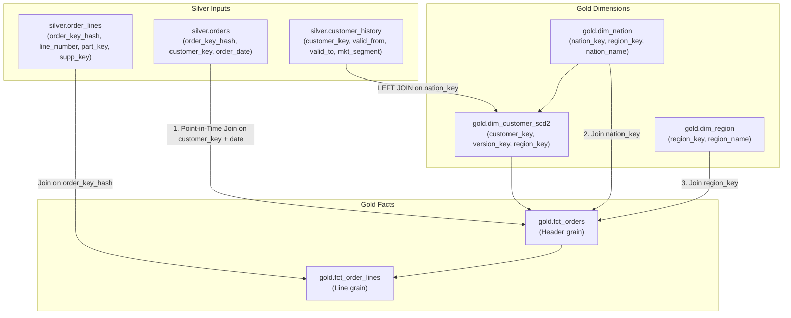

# Module 02: Pipeline Architecture & Joins

## 1. The Medallion Data Flow

The Lakehouse follows the Databricks Medallion pattern implemented through **Lakeflow Declarative Pipelines**:

```mermaid
flowchart LR
    subgraph Landing["Landing Volume"]
        direction TB
        V1["/Volumes/meridian_t02/landing/raw_files/"]
    end

    subgraph Bronze["Bronze (Ingestion)"]
        direction TB
        B1["bronze.orders\n(STREAMING)"]
        B2["bronze.lineitem\n(STREAMING)"]
        B3["bronze.customer\n(STREAMING)"]
        B4["bronze.{dims}\n(STREAMING)"]
    end

    subgraph Silver["Silver (Validation & Conformance)"]
        direction TB
        S1["silver.orders\n(MV, Dedup)"]
        S2["silver.order_lines\n(MV, Dedup)"]
        S3["silver.customer_changes\n(STREAMING)"]
        S4["silver.customer_history\n(AUTO CDC SCD2)"]
    end

    subgraph Gold["Gold (Star Schema)"]
        direction TB
        G1["gold.dim_customer_scd2\n(MV, Filtered)"]
        G2["gold.dim_supplier, etc.\n(MV, Filtered)"]
        G3["gold.fct_orders\n(Header Grain, PIT Join)"]
        G4["gold.fct_order_lines\n(Line Grain, Header Join)"]
    end

    Landing -->|Auto Loader read_files| Bronze
    Bronze -->|Data Quality EXPECT DROP| Silver
    Silver -->|Point-in-Time Join| Gold
```



---

## 2. Ingestion Mechanics: Auto Loader (`bronze.sql`)

Bronze tables use **Databricks Auto Loader** (`read_files` with `STREAM(...)`) pointing to Unity Catalog Volumes:

```sql
CREATE OR REFRESH STREAMING TABLE meridian_t02.bronze.orders AS
SELECT *,
  _metadata.file_path AS _source_file,
  CAST(regexp_extract(_metadata.file_path, 'batch=([0-9]+)', 1) AS INT) AS _batch_id,
  current_timestamp() AS _ingested_at
FROM STREAM(read_files('/Volumes/meridian_t02/landing/raw_files/orders/', format => 'parquet'));
```

### Lineage Metadata Columns:
- `_source_file`: Full URI of the raw parquet file from which each record originated.
- `_batch_id`: Integer extracted from the folder partition path (`batch=1`, `batch=2`, `batch=3`).
- `_ingested_at`: High-precision timestamp recording when the row entered the lakehouse.
- `order_key_hash`: Lowercase SHA-256 hash `lower(sha2(cast(o_orderkey as string), 256))` used to securely join orders and lines without exposing raw numeric sequence keys.

---

## 3. Silver Quality Expectations & Deduplication (`silver.sql`)

### Deduplication Strategy:
Instead of expensive full-row hashing, deduplication uses the deterministic **"newest file wins"** rule:
```sql
QUALIFY row_number() OVER (PARTITION BY o_orderkey ORDER BY _source_file DESC) = 1
```

### Declarative Expectations (`EXPECT ... ON VIOLATION DROP ROW`):
- `orders`: Ensures `order_key IS NOT NULL`, `customer_key IS NOT NULL`, order date within 1995, `order_total_price >= 0`, and `order_status IN ('O', 'F', 'P')`.
- `order_lines`: Ensures valid line numbers, positive quantities, non-negative extended prices, valid tax/discount rates ($0 \le \text{rate} \le 1$), and that `receipt_date >= ship_date`.
- Violating rows are automatically dropped from Silver and quarantined in `ops.quarantine_invalid`.

---

## 4. Detailed Join Architecture



### Join Step 1: Customer SCD2 & Geography (`dim_customer_scd2`)
`dim_customer_scd2` reads from `silver.customer_history` and joins with `gold.dim_nation` to inherit `customer_region_key`:
```sql
CREATE OR REFRESH MATERIALIZED VIEW meridian_t02.gold.dim_customer_scd2
WITH ROW FILTER meridian_t02.gov.region_nation_filter ON (customer_region_key, customer_nation_key)
AS
SELECT
  h.customer_key,
  h.customer_name,
  h.market_segment,
  h.customer_phone,
  h.customer_account_balance,
  h.customer_nation_key,
  n.region_key AS customer_region_key,
  h.__START_AT AS valid_from,
  h.__END_AT AS valid_to,
  h.__END_AT IS NULL AS is_current,
  concat(CAST(h.customer_key AS STRING), ':', CAST(h.__START_AT AS STRING)) AS customer_version_key
FROM meridian_t02.silver.customer_history h
LEFT JOIN meridian_t02.gold.dim_nation n ON h.customer_nation_key = n.nation_key;
```

### Join Step 2: Orders Point-in-Time Join (`fct_orders`)
The order header must reflect the customer's state **at the exact date the order was created**, not their current state:
```sql
SELECT
  o.order_key_hash,
  o.order_key,
  o.customer_key,
  o.order_date,
  o.order_total_price,
  o.order_status,
  h.customer_version_key,
  h.market_segment AS market_segment_at_order_time,
  h.customer_nation_key,
  h.customer_region_key,
  n.nation_name,
  r.region_name
FROM meridian_t02.silver.orders o
JOIN meridian_t02.gold.dim_customer_scd2 h
  ON o.customer_key = h.customer_key
 AND o.order_date >= h.valid_from
 AND (h.valid_to IS NULL OR o.order_date < h.valid_to)
JOIN meridian_t02.gold.dim_nation n ON h.customer_nation_key = n.nation_key
JOIN meridian_t02.gold.dim_region r ON n.region_key = r.region_key;
```

### Join Step 3: Line Items Header Linkage (`fct_order_lines`)
`fct_order_lines` joins `silver.order_lines` to `gold.fct_orders` on `order_key_hash`:
```sql
SELECT
  l.order_key_hash,
  l.line_number,
  l.order_key,
  l.part_key,
  l.supplier_key,
  l.quantity,
  l.extended_price,
  l.discount_rate,
  l.tax_rate,
  o.order_date,
  o.customer_key,
  o.customer_version_key,
  o.market_segment_at_order_time,
  o.region_name,
  (l.extended_price * (1 - l.discount_rate)) AS net_revenue,
  (l.extended_price * l.discount_rate) AS discount_amount,
  datediff(l.receipt_date, l.ship_date) AS transit_days,
  CASE WHEN l.receipt_date > l.commit_date THEN 1 ELSE 0 END AS is_late,
  IF(l.return_flag = 'R', 1, 0) AS is_returned
FROM meridian_t02.silver.order_lines l
JOIN meridian_t02.gold.fct_orders o ON l.order_key_hash = o.order_key_hash;
```

> **Crucial Architecture Note:** Because `fct_order_lines` joins directly to `gold.fct_orders`, lines whose headers have not yet landed in Gold will NOT appear in `fct_order_lines`. Instead, they remain in `ops.pending_order_lines` until their headers land, solving Advanced Challenge 2!
