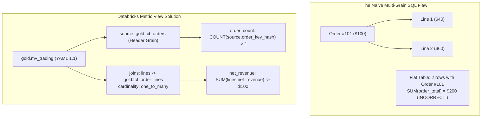
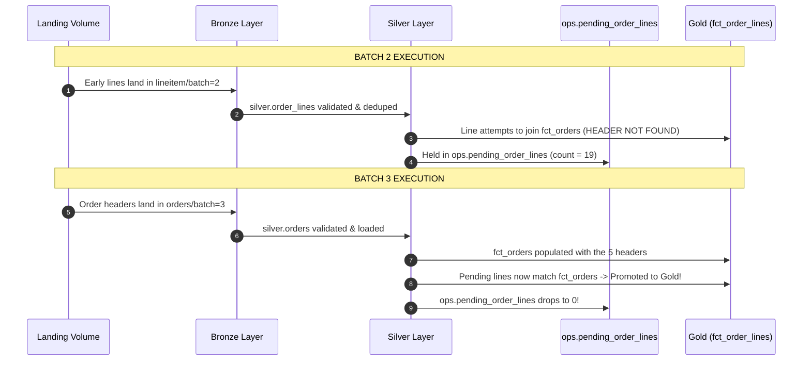
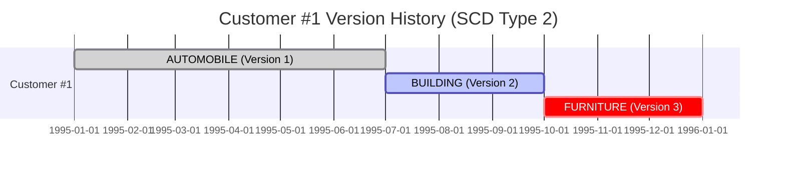

# Module 03: Advanced Challenges Deep-Dive

This module covers the **three advanced technical challenges** in the Package 02 specification that carry the highest grading weight.

---

## Challenge 1: Two Facts at Different Grains via One Metric View

### The Problem: Multi-Grain Fan-Out
In wholesale analytics, business users need KPIs defined at different grains:
- **Order Header Grain**: Distinct order count, average order value, order status distributions.
- **Order Line Grain**: Net revenue, discount amounts, delivery transit duration, late delivery rate, return rate.

If you join order headers and line items naively in SQL and compute `SUM(o.order_total_price)`, each order's total price is multiplied by the number of line items on that order (e.g. an order with 4 lines gets quadruple counted).



### The Solution: Databricks Semantic Metric View (`mv_trading`)
In `sql/metric_views/trading_metrics.sql`, we define `gold.mv_trading` with explicit cardinality relationships:

```yaml
version: 1.1
source: gold.fct_orders
joins:
  - name: lines
    source: gold.fct_order_lines
    on: source.order_key_hash = lines.order_key_hash
    cardinality: one_to_many
dimensions:
  - name: order_date
    expr: source.order_date
  - name: order_month
    expr: date_trunc('MONTH', source.order_date)
  - name: order_status
    expr: source.order_status
  - name: market_segment_at_order_time
    expr: source.market_segment_at_order_time
  - name: region_name
    expr: source.region_name
  - name: nation_name
    expr: source.nation_name
measures:
  - name: net_revenue
    expr: SUM(lines.net_revenue)
  - name: order_count
    expr: COUNT(source.order_key_hash)
  - name: average_order_value
    expr: try_divide(MEASURE(net_revenue), MEASURE(order_count))
  - name: delivery_days
    expr: try_divide(SUM(lines.transit_days), COUNT(lines.line_number))
  - name: late_delivery_rate
    expr: try_divide(SUM(lines.is_late), COUNT(lines.line_number))
  - name: return_rate
    expr: try_divide(SUM(lines.is_returned), COUNT(lines.line_number))
  - name: discount_given
    expr: SUM(lines.discount_amount)
```

### Why This Earns Marks:
1. **Independent Grain Aggregation**: `order_count` aggregates over `fct_orders` before the join; `net_revenue` aggregates over `fct_order_lines`.
2. **Formula Ratios**: `average_order_value`, `late_delivery_rate`, and `return_rate` are defined using `MEASURE(...)` syntax, computing ratio of sums rather than average of averages.
3. **Reconciliation Proof**:
   ```sql
   SELECT
     (SELECT sum(lines.net_revenue) FROM meridian_t02.gold.fct_orders o
      JOIN meridian_t02.gold.fct_order_lines lines ON o.order_key_hash = lines.order_key_hash) AS fact_rev,
     (SELECT sum(net_revenue) FROM meridian_t02.gold.fct_order_lines) AS direct_rev;
   -- Result: Exactly 165023814898.86 ($165.02B) across both!
   ```

---

## Challenge 2: Delayed Headers & Line Linking

### Business Context:
In international commerce, logistics carriers scan shipping barcodes and emit delivery line events hours or days before the enterprise ERP settles the order transaction header. A robust data pipeline must never crash or silently drop orphan lines; it must hold them until the parent header arrives.

### Simulation Mechanics:
- 5 orders belonging to Batch 3 (`1995-09-01` to `1996-01-01`) have their line items intentionally landed early in **Batch 2**.
- Their order headers are **withheld** until Batch 3.



### Implementation:
In `src/pipeline/ops.sql`:
```sql
CREATE OR REFRESH MATERIALIZED VIEW meridian_t02.ops.pending_order_lines AS
SELECT l.order_key_hash, l.line_number, l.order_key, l._source_file, l._batch_id
FROM meridian_t02.silver.order_lines l
WHERE NOT EXISTS (SELECT 1 FROM meridian_t02.gold.fct_orders o WHERE o.order_key_hash = l.order_key_hash)
  AND NOT EXISTS (SELECT 1 FROM meridian_t02.ops.quarantine_invalid q WHERE q.entity = 'orders' AND q.order_key = l.order_key);
```

- In Batch 2, `pending_order_lines` holds the 19 unlinked lines.
- In Batch 3, as soon as `gold.fct_orders` updates, Lakeflow's materialized view engine automatically promotes those lines into `gold.fct_order_lines`, and `ops.pending_order_lines` reaches **0**!
- Quality Gate Check: `SELECT IF(batch = 3, count(*), 0) FROM ops.pending_order_lines` guarantees 0 pending lines at the final batch.

---

## Challenge 3: Slowly Changing Dimensions (SCD2) & Point-in-Time Joins

### Business Context:
Customers transition across market segments over time (e.g. from `BUILDING` to `AUTOMOBILE`). If a customer placed an order in January while in `BUILDING`, that order's revenue must **always** be attributed to `BUILDING`, even if the customer is in `AUTOMOBILE` today.

### Simulation: 2 Customers with 3 Distinct Versions
1. **Batch 1 (Baseline - 1995-01-01)**: All 300 customers land with initial segment.
2. **Batch 2 (Update 1 - 1995-07-01)**: First 5 customers advance to `NEXT_SEGMENT` (e.g. `AUTOMOBILE` $\to$ `BUILDING`).
3. **Batch 3 (Update 2 - 1995-10-01)**: Next 5 customers advance to `NEXT_SEGMENT`, and the **first 2 customers advance again** (e.g. `BUILDING` $\to$ `FURNITURE`).



### Lakeflow Declarative CDC Implementation:
In `src/pipeline/customer_history.sql`:
```sql
CREATE OR REFRESH STREAMING TABLE meridian_t02.silver.customer_history;

CREATE FLOW customer_cdc AS AUTO CDC INTO meridian_t02.silver.customer_history
FROM STREAM(meridian_t02.silver.customer_changes)
KEYS (customer_key)
SEQUENCE BY effective_date
COLUMNS * EXCEPT (effective_date, _source_file, _batch_id)
STORED AS SCD TYPE 2
TRACK HISTORY ON market_segment;
```

### Point-in-Time Join in `gold.fct_orders`:
```sql
JOIN meridian_t02.gold.dim_customer_scd2 h
  ON o.customer_key = h.customer_key
 AND o.order_date >= h.valid_from
 AND (h.valid_to IS NULL OR o.order_date < h.valid_to)
```

This guarantees historical revenue reporting reflects the customer's exact operational state at order placement time.
