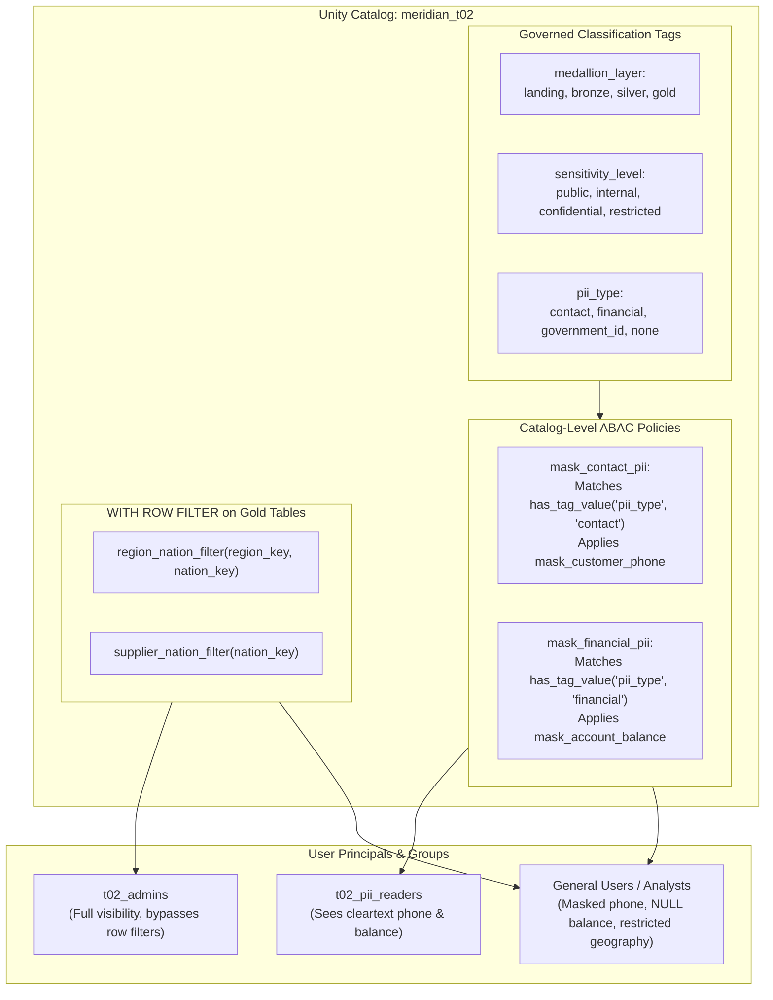

# Module 04: Governance, Security & Tag-Driven ABAC

This module explains the modern Unity Catalog security architecture, attribute-based access control (ABAC), and hierarchical row security.

---

## 1. Governance Architecture



---

## 2. Tag-Driven ABAC (Attribute-Based Access Control)

### Why ABAC over Explicit Table Masks?
- **Legacy Table-by-Table Masking (`SET MASK`)**: Every time a new table or view is created, an engineer must remember to manually alter the table and apply mask functions to specific columns. If a table is missed, sensitive PII leaks.
- **Modern Tag-Driven ABAC Policies**: You define the security policy **once** at the catalog level. Any column tagged with `pii_type = 'contact'` or `pii_type = 'financial'` is automatically and dynamically masked by the engine!

### Tag Definitions & Application (`sql/governance/apply_policies.sql`):
```sql
-- 1. Governed Tag Definition
CREATE GOVERNED TAG pii_type
  DESCRIPTION 'Type of personal identifiable information'
  VALUES ('contact', 'financial', 'government_id', 'none');

-- 2. Tag Sensitive Columns
ALTER TABLE gold.dim_customer_scd2
  ALTER COLUMN customer_phone SET TAGS ('pii_type' = 'contact', 'sensitivity_level' = 'confidential');

ALTER TABLE gold.dim_customer_scd2
  ALTER COLUMN customer_account_balance SET TAGS ('pii_type' = 'financial', 'sensitivity_level' = 'restricted');

ALTER TABLE gold.dim_supplier
  ALTER COLUMN supplier_account_balance SET TAGS ('pii_type' = 'financial', 'sensitivity_level' = 'restricted');

-- 3. Centralized ABAC Policy
CREATE OR REPLACE POLICY mask_contact_pii
ON CATALOG meridian_t02
COLUMN MASK meridian_t02.gov.mask_customer_phone
TO `account users`
FOR TABLES
MATCH COLUMNS has_tag_value('pii_type', 'contact') AS pii_col
ON COLUMN pii_col;

CREATE OR REPLACE POLICY mask_financial_pii
ON CATALOG meridian_t02
COLUMN MASK meridian_t02.gov.mask_account_balance
TO `account users`
FOR TABLES
MATCH COLUMNS has_tag_value('pii_type', 'financial') AS pii_col
ON COLUMN pii_col;
```

### Masking Behavior:
- **Phone Mask (`mask_customer_phone`)**:
  - `t02_pii_readers`: Sees original phone number (e.g. `25-989-741-2988`).
  - Other users: Sees partially masked string `XXX-XXX-2988`.
- **Account Balance Mask (`mask_account_balance`)**:
  - `t02_pii_readers`: Sees actual decimal account balance.
  - Other users: Receives typed `NULL` (`CAST(NULL AS DECIMAL(18, 2))`), completely concealing commercial financial balances.

---

## 3. Hierarchical Geographic Row Filtering

### Business Requirement:
Access to customer and supplier facts must respect geographic boundaries:
- A user granted a **Region** must automatically see all **Nations** inside that region.
- A user granted a **Nation** sees only that single nation.
- A user with no geographic entitlement sees zero rows.
- Administrators in `t02_admins` bypass all filters to see global data.

### Implementation:
In `sql/governance/functions.sql`:
```sql
CREATE OR REPLACE FUNCTION meridian_t02.gov.region_nation_filter(
  p_region_key BIGINT, p_nation_key BIGINT)
RETURNS BOOLEAN
COMMENT 'Region/nation entitlement row filter'
RETURN is_account_group_member('t02_admins')
    OR EXISTS (SELECT 1 FROM meridian_t02.gov.entitlements e
               WHERE e.principal = current_user()
                 AND (e.region_key = p_region_key OR e.nation_key = p_nation_key));
```

### Declaring on Materialized Views:
On Databricks Materialized Views, row filters must be declared **inside the `CREATE` statement** (`WITH ROW FILTER ... ON (...)`), not via `ALTER TABLE SET ROW FILTER`:
```sql
CREATE OR REFRESH MATERIALIZED VIEW meridian_t02.gold.fct_orders
WITH ROW FILTER meridian_t02.gov.region_nation_filter ON (customer_region_key, customer_nation_key)
AS SELECT ...
```

---

## 4. `is_account_group_member` vs `is_member`

| Feature | `is_account_group_member` (Modern UC) | `is_member` (Legacy Workspace) |
|---|---|---|
| **Scope** | Account-level group membership across all workspaces | Workspace-local groups or assigned groups only |
| **Databricks Recommendation** | Strongly recommended for all Unity Catalog row filters & column masks | Kept primarily for backward compatibility with legacy hive_metastore |
| **Enterprise Portability** | Policies work seamlessly when migrating across dev, staging, and prod workspaces | Breaks if group IDs differ across individual workspaces |
| **Audit Compliance** | Centralized identity management via SCIM / Okta / Azure AD | Fragmented per-workspace group maintenance |
