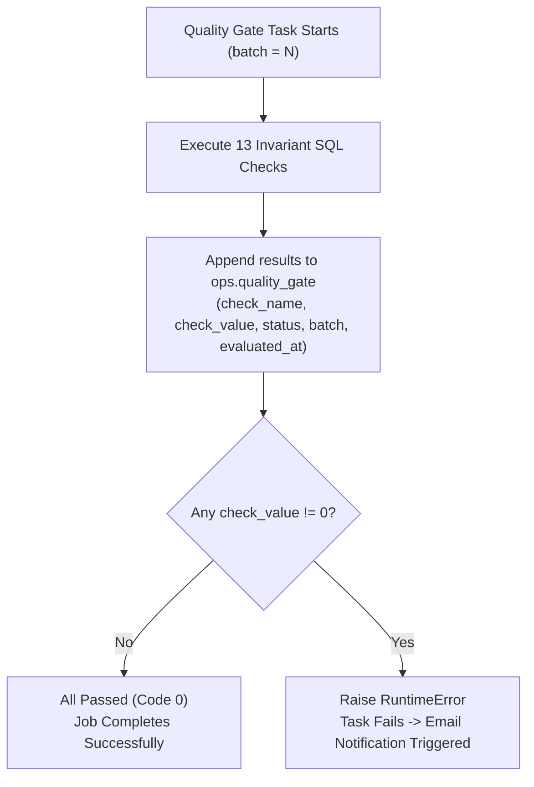

# Module 05: Quality Gate & Operational Monitoring

This module covers pipeline validation invariants, telemetry logging, and how to execute the **deliberate failure and repair demonstration** required by the evaluation rubric.

---

## 1. Quality Gate Architecture

The Quality Gate ([quality_gate.py](file:///home/sameed/meridian-trading/src/quality_gate/quality_gate.py)) enforces data engineering invariants using pure SQL checks that must return **0** to pass.



---

## 2. The 13 Invariant Checks

| Category | Check Name | Logic / Invariant |
|---|---|---|
| **Gold Non-Empty** | `gold_orders_not_empty` | `fct_orders` row count must be $> 0$ |
| | `gold_lines_not_empty` | `fct_order_lines` row count must be $> 0$ |
| **Uniqueness** | `silver_orders_no_duplicates` | Zero duplicate `order_key` in `silver.orders` |
| | `silver_lines_no_duplicates` | Zero duplicate `(order_key, line_number)` in `silver.order_lines` |
| | `gold_orders_no_duplicates` | Zero duplicate `order_key` in `gold.fct_orders` |
| | `gold_lines_no_duplicates` | Zero duplicate `(order_key, line_number)` in `gold.fct_order_lines` |
| **Referential Integrity** | `fct_orders_no_orphan_customer` | Every `fct_orders` row joins to an existing customer in `dim_customer_scd2` |
| | `fct_lines_no_orphan_part` | Every `fct_order_lines` row references a valid part in `dim_part` |
| | `fct_lines_no_orphan_supplier` | Every `fct_order_lines` row references a valid supplier in `dim_supplier` |
| **Bronze Reconciliation** | `reconcile_orders` | $|\text{Bronze} - \text{Silver} - \text{Quarantine} - \text{Duplicates}| = 0$ |
| | `reconcile_lineitem` | $|\text{Bronze} - \text{Silver} - \text{Quarantine} - \text{Duplicates}| = 0$ |
| **SCD2 Integrity** | `single_open_customer_version` | Zero customers with more than one open version (`__END_AT IS NULL`) |
| **Pending Line Check** | `no_pending_lines_at_final_batch` | Zero pending lines at Batch 3 (`SELECT IF(batch = 3, count(*), 0) FROM ops.pending_order_lines`) |

### The Bronze Reconciliation Equation:
In traditional pipelines, accounting for dropped rows requires complex bookkeeping tables. Here, reconciliation is calculated directly from the data:
$$\text{Bronze Rows} = \text{Silver Rows} + \text{Quarantined Rows} + (\text{Bronze Total} - \text{Bronze Distinct Keys})$$
This directly accounts for every single ingested record without needing intermediate state.

---

## 3. Deliberate Failure & Repair Demonstration

The evaluation requires showing a **failed run in the job history** followed by an automated or configured repair.

```mermaid
sequenceDiagram
    autonumber
    participant Dev as Engineer / Trainer
    participant Job as meridian_t02_job
    participant QG as quality_gate.py
    participant DB as Databricks UI

    Note over Dev,DB: PHASE 1: INDUCE DELIBERATE FAILURE
    Dev->>Job: Trigger run with an intentional test violation (or invalid order)
    Job->>QG: Evaluates checks
    QG->>QG: Finds non-zero check_value (e.g. orphan customer or broken reconciliation)
    QG->>Job: Raises RuntimeError("Quality gate failed: [...]")
    Job-->>DB: Job status marked RED (FAILED)
    Note over DB: Email notification sent; failure logged in system.lakeflow

    Note over Dev,DB: PHASE 2: REPAIR & PROVE PASS
    Dev->>Job: Remove defect / re-run clean batch
    Job->>QG: Re-evaluates all 13 checks
    QG->>QG: All 13 check values = 0
    Job-->>DB: Job status marked GREEN (SUCCEEDED)
```

### Steps to Demo:
1. **To Fail**: Temporarily modify `quality_gate.py` to assert `count(*) = 999999` on `fct_orders`, or drop a row from `gold.dim_part` so an orphan check fails.
2. **Execute Job**: Run `databricks bundle run meridian_t02_job`. The run terminates with `FAILED`. Show the trainer the red run in Databricks Job Runs UI.
3. **To Repair**: Restore the valid condition and re-run. Show the subsequent green run in Job Runs UI.

---

## 4. Failed-Run Alert (Stretch Goal)

We created `sql/analysis/failed_run_alert.sql` querying Databricks system tables:
```sql
SELECT count(*) AS failed_runs_last_24h
FROM system.lakeflow.job_run_timeline r
JOIN system.lakeflow.jobs j ON r.job_id = j.job_id
WHERE j.name LIKE '%meridian_t02_job%'
  AND r.result_state = 'FAILED'
  AND r.period_start_time >= current_timestamp() - INTERVAL 24 HOURS;
```

A **Databricks SQL Alert** is configured on this query:
- Threshold: Trigger when `failed_runs_last_24h > 0`.
- Frequency: Evaluated every 1 hour.
- Notification: Dispatches immediate alert to workspace operators.
